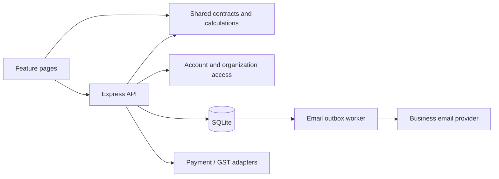

# Application structure

Venturecore INV runs as one Node.js service with a React frontend and a persistent SQLite database. The service serves the built frontend and `/api` on one origin. It also processes the transactional email outbox. Payment/email providers run outside the application; provider settings remain server-side.

## Directory map

| Path                                   | Responsibility                                                                                            |
| -------------------------------------- | --------------------------------------------------------------------------------------------------------- |
| `src/app/`                             | Workspace shell, URL routing, organization context and navigation                                         |
| `src/features/auth/`                   | Public home, login, signup and password-reset pages                                                       |
| `src/features/organizations/`          | Organization settings, legal identity, GST, bank/QR and workspace branding                                |
| `src/features/contacts/`               | Organization contact directory and customer/vendor/B2B forms                                              |
| `src/features/documents/`              | Document editor, preview and browser PDF output                                                           |
| `src/features/catalog/`                | Products/services, reusable pricing controls and ecosystem business products                              |
| `src/features/formats/`                | Saved invoice format library and format editing                                                           |
| `src/features/payments/`               | Receipts, installments and online payment controls                                                        |
| `src/features/messaging/`              | Invoice email composition/status/history                                                                  |
| `src/features/team/`                   | Staff approval and organization assignments                                                               |
| `src/features/integrations/`           | Per-business payment/email readiness and setup information                                                |
| `src/shared/`                          | Reusable UI, API client and global styles                                                                 |
| `shared/`                              | Pure domain types, financial calculations, identity helpers, presets and API contracts used by both sides |
| `server/app.ts`                        | Express application composition, API routes and cross-service transactions                                |
| `server/index.ts`                      | Environment loading, startup, email worker and graceful shutdown                                          |
| `server/auth/`                         | Accounts, sessions, password resets and organization authorization                                        |
| `server/db/`                           | SQLite creation, migration and default records                                                            |
| `server/config/`                       | Organization-scoped server integration settings                                                           |
| `server/http/`                         | Response security headers and request-query validation                                                    |
| `server/validation/`                   | Validated business/API input schemas                                                                      |
| `server/documents/`                    | Server-side invoice PDF attachment preparation                                                            |
| `server/integrations/gst/`             | GST portal CAPTCHA/lookup adapter                                                                         |
| `server/integrations/payments/`        | Gateway dispatch, Razorpay and Cashfree verification/reconciliation                                       |
| `server/integrations/email/`           | Persistent outbox, sender isolation and Resend delivery                                                   |
| `server/integrations/provider-http.ts` | Bounded upstream JSON responses and rejected-response cleanup                                             |
| `tests/server/`                        | API, data, auth and provider-adapter tests                                                                |
| `tests/shared/`                        | Pure domain/calculation/PDF contract tests                                                                |
| `tests/frontend/`                      | Frontend route and navigation contract tests                                                              |
| `scripts/`                             | Development/test/package tooling                                                                          |
| `.data/`                               | Private runtime database and source assets; excluded from Git and deployment archives                     |
| `dist/` / `release/`                   | Generated frontend / application-only upload archives                                                     |

## Import boundaries

Shared domain modules do not access the DOM, environment variables, network or database. A monetary formula or saved-record contract belongs in `shared/` so browser, API, PDF and email agree. Frontend feature components use the shared API client and contracts; they never import server credentials or database code. Server integrations use injected HTTP clients in tests and server settings at runtime.

Keep account authorization and validation on the server even when the UI hides unavailable actions. The page router determines what to show; it does not determine whether a person may read or change the record. Organization IDs are checked against the saved resource, not just a submitted query value.

## Pages and saved state

Public pages use `/`, `/login`, `/signup`, `/forgot-password` and `/reset-password`. A reset token stays in the URL fragment (`#token=...`); existing `#reset-password?token=...` links remain supported. Workspace pages use `/workspace/:organizationId/:view/:action?/:id?`. Small query parameters may preselect a contact role, catalog item type or business product; they are validated as UI inputs.

The browser History API drives full pages and Back/Forward navigation. The server's frontend fallback serves these paths while unknown `/api` routes still return API errors. Refreshing a saved-record URL reloads the authorized record. Unsaved form state is not a substitute for persisting a draft. A URL never contains a password, session token, provider key, bank detail or serialized invoice.

Feature pages render in the normal document flow. They do not use overlay modals, modal focus traps or body-scroll locks. Browser file selection, printing and download behavior remain native browser features. Destructive actions retain a visible confirmation step on the page and the same server restrictions.

## Business data and integrations

Each organization owns its contacts, catalog, formats and documents. Five seeded organizations are Venturecore divisions; Shri Sarraf is independent. A document saves its issuer, selected GST registration, contact, format, branding and pricing snapshots. Editing current defaults does not silently rewrite issued documents or their payment identity.

Amounts and receipt allocations use integer paise at financial boundaries. Verified payment receipts and their notification records commit together. Provider IDs, scoped event IDs and request identifiers prevent repeated callbacks from crediting the ledger twice. Full payment locks the same invoice number as Paid / Final. An active or unresolved payment link blocks competing financial edits.

`server/config/` resolves the complete per-business credential group. Independent businesses never use global company gateway/email credentials. The email outbox freezes sender/body/attachment/support details and the credential fingerprint for safe retries; API keys are never stored in queued message payloads. See [Platform setup](PLATFORM_SETUP.md) for actual settings and provider activation.

## Development and packaging

Run `npm ci --include=dev`, `npm test` and `npm run build` from the repository root with Node.js 24+. The test runner recursively discovers `*.test.ts` files under `tests/` and rejects an empty test run. Use a temporary `DATABASE_PATH` for browser checks. The development checkout includes tests, while upload packages intentionally contain only application files and setup documentation.

`npm run package:preview` builds and packages an explicit list of roots. Add a new runtime root to that list when splitting modules. Do not replace the allowlist with an archive of the entire checkout: `.data`, `.env`, uploaded certificates, credentials and backups must remain private. `tsx` is a runtime dependency; TypeScript/Vite and their types remain build tools.

`server/operations/` owns online backup verification, retention, the automatic scheduler and persisted recovery holds. `scripts/database.mjs` performs private offline backup/recovery commands without starting provider workers; `scripts/check-deployment.mjs` reports configuration readiness without revealing secrets. The admin full-page UI lives in `src/features/backups/`. Backup downloads include the SQLite file and a separate manifest; originals/environment secrets are separate. Recovery guards run before application initialization and refuse pending recovered databases.
